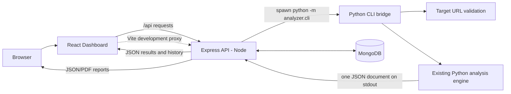
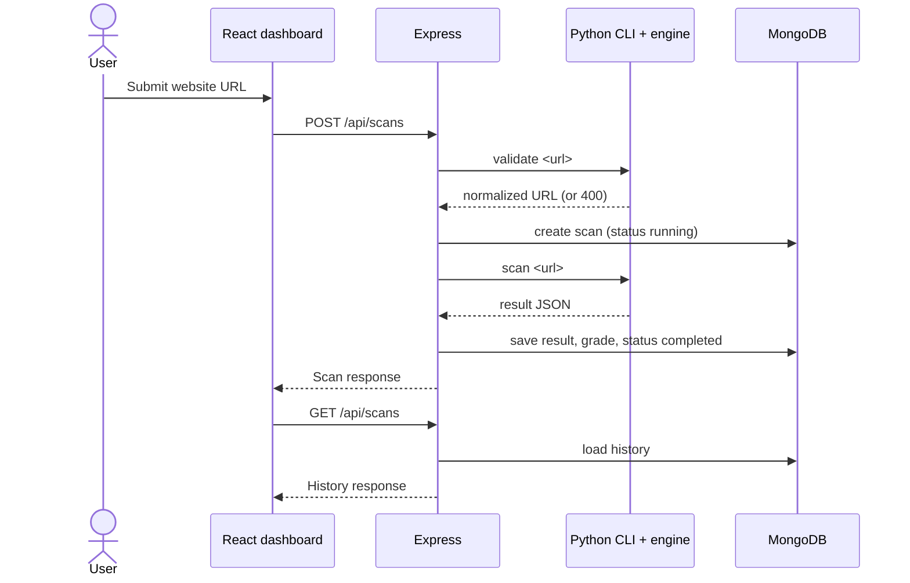

# Architecture

## System diagram

## Components

### React dashboard

Unchanged apart from branding text. It submits a target URL, shows results and history, and talks to `/api/...`. Vite proxies `/api` to the Express server on port 8000.

### Express API (`server/`)

`server/src/routes/scans.js` exposes health, scan submission, history, single-scan retrieval, and JSON/PDF report routes with the same paths, status codes and `{ "detail": ... }` error bodies as the former FastAPI service. It validates the payload, persists scan records with Mongoose, and delegates all analysis to Python.

Scans run inside the HTTP request (as before). To protect the host, the API enforces a per-scan timeout (`SCAN_TIMEOUT_MS`, kills the whole Python/Firefox process group) and a concurrency cap (`MAX_CONCURRENT_SCANS`, HTTP 429 beyond it).

### Python analyzer (unchanged engine)

`gdpr_analyzer.py` and `modules/` (cookies, web beacons, crypto, report) are untouched. The only new Python is a thin bridge in `analyzer/`:

- `analyzer/cli.py` – commands `validate <url>`, `scan <url>`, `report <label> <out.pdf>` (result JSON on stdin). Each prints exactly one JSON document on stdout; the analyzer's own console output is redirected to stderr.
- `analyzer/target.py` – the former `normalize_target` (SSRF baseline checks).
- `analyzer/scanner.py` – the former `run_scan` adapter.

`server/src/services/analyzer.js` spawns the CLI, enforces timeouts, and maps a validation failure to HTTP 400.

The URL validation is a baseline safeguard, not a complete isolation boundary. Redirects, DNS rebinding, alternate IP representations, and changing DNS responses must be considered before exposing this endpoint to untrusted users.

### Persistence: MongoDB and Mongoose

`server/src/models/Scan.js` defines the `scans` collection (target, status, grade, error, `created_at`, result). Scans keep small sequential numeric ids through an atomic counter document, so the UI ("Scan #7") and URLs are unchanged. The analyzer result is stored as a JSON string, because cookie names are used as keys in the result and may contain `.` or `$`, which MongoDB field names handle poorly; the API parses it back into the same nested `result` object.

`compose.yaml` runs MongoDB with a named volume. Do not use `docker compose down -v` unless you intend to delete the data.

### Reports

JSON is served from the stored record. PDFs are generated by the existing ReportLab module through `analyzer.cli report`. Downloading a report never triggers a new scan.

## Scan lifecycle

## Data flow and trust boundaries

1. The browser submits an untrusted URL to the API.
2. The API validates the request payload and asks the Python bridge to validate the URL.
3. The Python engine makes outbound requests to the target and runs the analysis modules.
4. The bridge returns the result as JSON, which the API saves in MongoDB.
5. The frontend displays the saved result and history.
6. Report endpoints serialize the saved assessment into downloadable JSON or PDF.

The API performs outbound network requests based on user input. Server-side request forgery (SSRF) is consequently a major risk and needs defense in depth, including redirect validation and outbound network restrictions.

## Current result contract

The current nested result shape includes:

- `cookies`: `grade`, `score`, `details`
- `web_beacons`: `grade`, `score`, `url`
- `security_transmission`: `hostname`, `grade`, `note`, `protocol`, `key`, `cipher`, `certificate`
- top-level `target` and `grade`

Fields can vary depending on what the analyzer returns. A missing module or empty object/list means data was not reported in that field; it must not automatically be displayed as a definitive pass.
